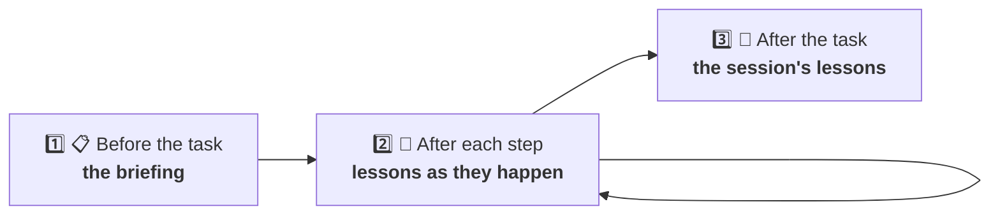
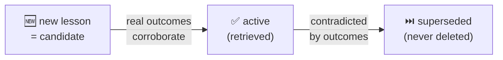

<div align="center">

# 🔌 Using Persona in a host agent

**Three hooks in your run loop. That's the whole integration.**

</div>

<p align="center"><sub>📄 Prefer plain text with every detail? <a href="docs/plain/INTEGRATION.md">Read the plain version</a></sub></p>

> [!IMPORTANT]
> **Each hook never raises:** a Persona problem never breaks a run.



---

## 1️⃣ 📋 Before the task — the briefing

```python
from persona.ground import compile_run_ground
brief = compile_run_ground(task_text, root=".", instance_id=run_id)
if brief:
    messages.append({"role": "system", "content": brief})
```

The panel (the pblocks named in `AURA_PBSEATS`, or every pblock in the stores folder) retrieves the cases closest to the task, its judges decide what applies, and the briefing lists them with what worked and what failed.

> [!TIP]
> **Key it on the real task text** — the problem as the user stated it — not on a generic instruction: the precedents are only as relevant as the text they are matched against. An empty string means nothing applied; add nothing.

---

## 2️⃣ 👣 After each step — lessons as they happen

```python
from persona.learn import learn_step_pairs
learn_step_pairs(session, work_dir, step, task_text)
```

`session.messages` is the conversation (role/content dicts, tool results with `role: "tool"`).

| When | What happens |
|---|---|
| ❌ → ✅ a step's tool errors are followed by a step that works | the model's own words for what it did differently become a **candidate lesson** |
| 🗑️ raw tool output and step noise | **never stored** (`persona.quality`) |

---

## 3️⃣ 🏁 After the task — the session's lessons

```python
from persona.learn import learn_from_session
learn_from_session(session, work_dir, record, task_text)
```



New lessons start as **candidates** and influence nothing until real outcomes corroborate them; a lesson contradicted by outcomes is superseded, never deleted. **Only active lessons are ever retrieved.**

---

## ⚙️ Settings (environment)

| Variable | Default | Meaning |
|---|---|---|
| `AURA_PBLOCKS` | `1` | `0` turns every hook off |
| `AURA_PBSTORES` | — | the stores folder (else `PBLOCKS_STORES`, else `./pblock-stores`) |
| `AURA_PBSEATS` | all | comma-separated pblocks in the panel |
| `AURA_PBGROUND` | `1` | `0` skips the briefing only |
| `AURA_PBLEARN` | `1` | `0` skips learning only |
| `AURA_PB_PANEL_PROFILE` | `flash` | briefing size: `flash` (~18 lines), `full` (~38), `simple` (flat) — see [PANEL-PROFILE-RULE.md](PANEL-PROFILE-RULE.md) |
| `AURA_PBLEARN_DEBUG` | — | print the engine's diagnostics |

---

## 📁 Files of a pblock

| File | Holds |
|---|---|
| 📜 `<name>.yml` | template: territory, labels, gates |
| 📚 `<name>_store.jsonl` | the cases (or the packed pair below) |
| 🧬 `<name>_embeddings.npy` | packed: float32 [N, 384] |
| 📄 `<name>_meta.jsonl` | packed: one row per case, same order |
| ⚖️ `weights/<name>_heads.json` | the trained judges |
