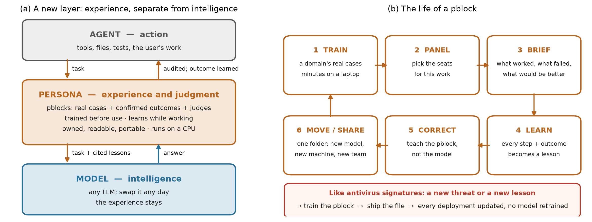

<div align="center">

# Persona

## Your model has intelligence. Persona gives it experience.

**What worked, what failed, and why — kept as plain data you own, cited in every judgment,<br>grown from real outcomes, and still there when you change the model.**

[](LICENSE)
[](pyproject.toml)
[](#-quick-start)
[](https://huggingface.co/datasets/Kresearch/persona-pblocks)

[**Quick start**](#-quick-start) · [**How it works**](#-how-it-works) · [**Keel Guard**](#keel-guard) · [**Results**](#-results) · [**Use it in your agent**](#-use-it-in-your-agent) · [**Evidence**](https://github.com/kresearch-labs/persona-evidence)

<br>



</div>

<br>

On Monday, a coding agent pins a library to an old version and breaks the build. You explain why that's wrong. On Thursday, in a new session, it does it again. Nothing was wrong with the model's intelligence — it simply had no **experience**: the lesson died with Monday's chat.

Every AI system works this way today. Fine-tuning doesn't fix it: it forgets earlier skills, costs a training run per lesson, hides the lesson where no one can read it, and is lost the day the model is retired.

**Persona is a separate layer for experience.** A **pblock** is one persona's experience as plain data — real situations with their confirmed outcomes, plus small calibrated judges over a frozen 22 MB embedder. Before a task, a **panel** of pblocks tells the model what worked, what failed and what would be better, citing the cases behind it. After the task, what actually happened is written back. Teach the pblock and the system remembers; swap the model and the experience stays.

## 🔁 How it works

| Step | What happens |
|---|---|
| **1 · Train** | A pblock is trained before use on a domain's real cases — on a CPU, in minutes. The work is the corpus, not the compute. |
| **2 · Panel** | Several pblocks are consulted together for the work at hand, each judging from its own store. Precedence is fixed: security > correctness > style. |
| **3 · Brief** | Before each task the panel retrieves the nearest cases, its judges decide what applies, and the model gets a short briefing with the cases cited. No precedent? It says "we don't know" instead of guessing. |
| **4 · Learn** | Each step and each finished task becomes a lesson. A new lesson starts as a low-confidence candidate and gains influence only when real outcomes confirm it — never on the model's opinion of itself. |
| **5 · Correct** | Teach the pblock, not the model: a correction is one readable case; a retrain swaps the judges only if they pass their gates. Nothing is fine-tuned, so it's immediate and reversible. |
| **6 · Move** | A pblock is one folder. Copy it to another machine, another model, another team. Wrong lessons are superseded, not erased — the history of what it believed, and why it changed, stays readable. |

**One real case**, from the software-strategy pblock used in the paper:

> **situation:** a guard-clause patch at a single call site with no test coverage<br>
> **lesson:** the blast radius is never stated and the patch silently touches unrelated modules<br>
> **outcome:** failed — *status:* active, with its creation time kept

Before a similar task, that line reaches the model as a warning. If later outcomes contradict it, it is superseded, not deleted.

## 🏆 Why a separate layer

| | Fine-tuning | Notes in the prompt | **Persona** |
|---|---|---|---|
| Where a lesson lives | Hidden in the weights | Mixed into the context | A readable case with its source and outcome |
| Cost of teaching one thing | A training run | Free, but it piles up | One case; judges refit on a CPU |
| When the model is replaced | Lost | Re-tuned for the new model | Stays — move the folder |
| What it learns from | Whatever you train on | Whatever is written down | Confirmed outcomes only; candidates first |
| Knows when it doesn't know | No | No | Calibrated judges; abstains with no precedent |
| Shows why | No | Sometimes | Every judgment cites its cases |
| Undo a bad lesson | Retrain | Edit and hope | Supersede the case; snapshots roll back |

<a id="keel-guard"></a>

## 🛡️ Keel Guard: an antivirus for agent requests

The same engine is a guard. **Keel Guard** is a security pblock that reads an agent's request and answers **STOP**, **DOUBT** (the agent's model or a human checks), or **PASS** — outside the model, on a CPU, citing the cases behind each verdict. A new kind of misuse is answered the way antivirus answers a new virus: train the pblock on the new cases and ship the file. No model is retrained.

On 750 requests it had never seen, it stopped **89.4%** of harmful ones at a median **34 ms** on a CPU — including requests a safety model judged safe. Its weakness is just as clear: it also stopped 55.2% of benign requests that only *sound* risky. That is the next training target, and Keel Guard is built to keep growing: every new misuse case and every benign look-alike added to its store makes it sharper. [Get it on Hugging Face](https://huggingface.co/datasets/Kresearch/persona-pblocks) — and help train it.

## 📊 Results

First experiments, one consumer PC, a low-cost flash model, everything released:

| Test | Without Persona | **With Persona** |
|---|---|---|
| SWE-bench Verified, 1,000 paired runs | 88.0% | **89.0%** — fewer steps, ~12% less compute |
| Sealed five-field test (medicine, law, creative, finance, tutoring) | 83.0% | **85.4%** |
| Keel Guard, 750 never-seen requests | — | **89.4%** harmful stopped · 34 ms on a CPU |

Pblocks grown the same way in eleven domains — forecaster, astronomer, detective, mathematician, film, game designer, doctor, lawyer, teacher, historian, accessibility — each from real public data. Every grade report, receipt and session tape is in [persona-evidence](https://github.com/kresearch-labs/persona-evidence); `python recompute_swe_totals.py` reproduces the headline.

## ⚡ Quick start

```bash
pip install git+https://github.com/kresearch-labs/Persona.git
```

Python 3.10+; the frozen embedder (all-MiniLM-L6-v2, int8 ONNX, Apache-2.0) ships inside. Train a toy pblock:

```bash
git clone https://github.com/kresearch-labs/Persona.git && cd Persona/docs/toy-example
python make_corpus.py                      # the corpus, from a declared decision space
python -m persona.train_pblock --template toy-pblock.yml --out-dir out
```

The trainer embeds every situation, fits one judge per label plus an outcome judge (5-fold cross-validated), builds the case store, and prints a PASS/FAIL gate report. Building a real pblock — the decision space, real records with their sources, no padding — is in [`docs/TRAINING-PBLOCKS.md`](docs/TRAINING-PBLOCKS.md).

Want it already built into an agent? [**Aura**](https://github.com/kresearch-labs/aura-agent) has Persona inside: `/persona train`, `/persona learned`, `/persona review`.

## 🔌 Use it in your agent

Any agent that can add one message before a task and read the session after it can use Persona. Three hooks:

```python
from persona.ground import compile_run_ground
from persona.learn import learn_step_pairs, learn_from_session

# 1. before the task: the panel's cited precedents, as one system message
brief = compile_run_ground(task_text, root=".", instance_id=run_id)
if brief:
    messages.append({"role": "system", "content": brief})

# 2. after each step: an error followed by a working step becomes a lesson
learn_step_pairs(session, work_dir, step, task_text)

# 3. after the task: lessons from the whole session (as candidates)
learn_from_session(session, work_dir, record, task_text)
```

Stores are read from `AURA_PBSTORES` (or `PBLOCKS_STORES`, or `./pblock-stores`); `AURA_PBSEATS` limits the panel to the named pblocks; `AURA_PBLOCKS=0` turns everything off. Pblocks ship packed — `<name>_embeddings.npy` + `<name>_meta.jsonl`, about 79% smaller and loaded in seconds; `store.pack()` writes that form. Details: [`INTEGRATION.md`](INTEGRATION.md).

## 📚 Learn more

- [`docs/HOW-PBLOCKS-WORK.md`](docs/HOW-PBLOCKS-WORK.md) — how Persona and its pblocks work, simply
- [`docs/TRAINING-PBLOCKS.md`](docs/TRAINING-PBLOCKS.md) and [`docs/CORPUS_TRAINING_METHODOLOGY.md`](docs/CORPUS_TRAINING_METHODOLOGY.md) — growing a real pblock
- [`docs/ENGINE_README.md`](docs/ENGINE_README.md) — the making flow
- [`PANEL-PROFILE-RULE.md`](PANEL-PROFILE-RULE.md) — sizing the briefing to the model
- [Trained pblocks](https://huggingface.co/datasets/Kresearch/persona-pblocks) · [Evidence](https://github.com/kresearch-labs/persona-evidence)

## 🤝 Reproduce, extend, contribute

Every experiment so far ran on one consumer PC. We'd love to see them on proper infrastructure: rerun the paired SWE-bench test with stronger models, rerun the five-field test with a significance test, keep training Keel Guard, and grow pblocks in new domains. Results from others — whatever they show — will be linked here. Issues and pull requests are welcome.

## 📄 License

MIT — see [LICENSE](LICENSE).
